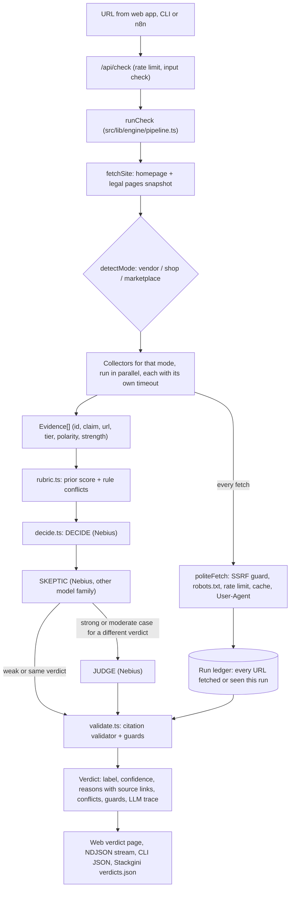

# Architecture

## Data flow

Notes:
- A collector that fails or times out becomes a visible `collector_error` event; the run continues (`src/lib/collectors/run.ts`).
- If the AI decision step fails entirely, the verdict is `Unsure` with confidence 0, never a guess.
- Skeptic failure is not fatal; judge failure keeps the draft.
- Model calls go through `src/lib/llm/nebius.ts`, which itself uses `politeFetch`.

## Evidence tiers

| Tier | Meaning | Prior weight |
|---|---|---|
| `claimed` | the subject says it about itself | 1 |
| `time` | proven by time (registration, archive, certificates) | 2 |
| `third_party` | confirmed by independent sources | 3 |
| `red_flag` | breach, insolvency, scam reports, warnings | 4 |

Prior score = sum of tier weight x strength (1-3), added for `supports`, subtracted for `undermines`. Fewer than 3 evidence items gives `Unsure`; score >= 10 gives `Trust`, <= -4 gives `Avoid`, otherwise `Caution`. It is a hint to the model, not the verdict.

## Collectors

"Tavily" = search or extract through `src/lib/net/tavily.ts`. Fetches of the site under test are limited (robots.txt, 1 request per second, at most 8 per 10 minutes per host).

| Collector | Modes | Signal | Source | Tier |
|---|---|---|---|---|
| `site` | vendor, shop | claimed customers, copyright year, imprint, generator, dead links, blocked or unreachable site | the site's own pages | claimed |
| `rdap` | vendor, shop | domain registration year (platform subdomains flagged) | RDAP via rdap.org | time |
| `wayback` | vendor, shop | first capture year; year the brand first appears in a snapshot (binary search) | Wayback Machine | time |
| `certs` | vendor, shop | first certificate issued | crt.sh (Certificate Transparency) | time |
| `dns` | vendor, shop | email stack (MX provider), SPF/DMARC-style records | Google Public DNS | claimed |
| `alive` | vendor | recent product activity: changelog, blog, status page, GitHub pushes | site pages, GitHub API | time |
| `mentions` | vendor, shop | customers or press naming the brand on independent sites, review sites | Tavily search and extract | third_party |
| `registers` | vendor, shop | company register entry, active or inactive (German HRB/HRA from imprint, UK Companies House, OpenCorporates, North Data) | Tavily | third_party (red_flag if inactive) |
| `risk` | vendor, shop | known data breaches; risk or acquisition news | HaveIBeenPwned, Tavily news | red_flag (third_party for acquisition) |
| `shop-product` | shop | product identity, listing age, price, claimed "since" year vs. history | product JSON-LD / Shopify JSON | claimed, time |
| `shop-legal` | shop | imprint with company name and address, returns policy, contact, Asia address, free-mail contact | the shop's legal pages | claimed (red_flag when missing or suspicious) |
| `shop-payments` | shop | buyer-protected payments vs. prepayment, crypto, gift cards, Western Union only | shop page | claimed, red_flag |
| `shop-watchlists` | shop | fake-shop warning lists, Trustpilot and ScamAdviser snippets, Reddit complaints | Tavily | red_flag, third_party |
| `shop-dropship` | shop | product is a marked-up AliExpress/Temu item; photos look AI-generated | Tavily image search + vision model on Nebius | third_party, red_flag |
| `mp-listing` | marketplace | parses the listing once per run (title, brand, price, seller, rating); shared by the other mp collectors | listing page, else Tavily extract or search; extract model on Nebius | claimed |
| `mp-price` | marketplace | listing price vs. typical market price, same currency only | Tavily -> idealo, geizhals, pricespy, Keepa, CamelCamelCamel | red_flag if far below, third_party otherwise |
| `mp-brand` | marketplace | does the brand's own site sell this product; any web presence outside marketplaces | Tavily | third_party (claimed if generic brand) |
| `mp-seller` | marketplace | sold by the marketplace itself; scam reports about the seller | listing, Tavily | claimed, red_flag |
| `mp-images` | marketplace | main image shows the titled product; looks AI-generated | vision model on Nebius | third_party |

## Guards that never depend on the model

- `politeFetch` is the only place `fetch` is called (ESLint blocks the global `fetch` and axios, node-fetch, got, undici, request).
- SSRF guard (`src/lib/net/guard.ts`): public http(s) hosts on ports 80 and 443 only, checked on every redirect hop; private, reserved and special-purpose IPv4/IPv6 ranges blocked.
- Run ledger (`src/lib/net/ledger.ts`): the validator only accepts citations whose URL was fetched or returned by search this run.
- Model prompts receive only numeric and boolean `data` fields from evidence; free text scraped from pages stays out of the prompt except as the one-sentence claim.
